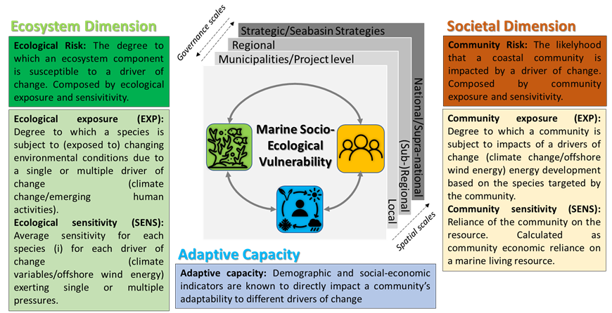
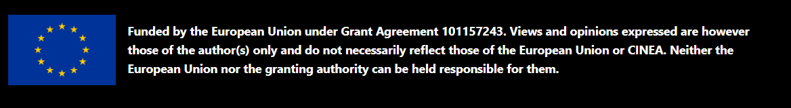

# SEADITO Pan-EU Demonstrator: Marine Socio-Ecological Vulnerability (MSEV)

Interactive Shiny application mapping Marine Socio-Ecological Vulnerability (MSEV)
for coastal NUTS3 regions across Europe, developed within the SEADITO project.

Socio-ecological vulnerability refers to the extent to which human activities and
climate change induce environmental degradation that affects the exposure,
sensitivity, and adaptative capacity of a social-ecological system to anticipate,
cope with, and recover from hazards (adapted from Depietri 2020). MSEV combines
three components: Ecological Risk, Community Risk and Adaptative Capacity.



## What the app shows

- **Fisheries and climate change:** how projected shifts in habitat suitability of
  14 commercial fish species by 2100 (RCP8.5) affect the coastal communities that
  depend on them. Species projections come from MaxEnt models built on the OCLE
  database (de la Hoz et al. 2025).
- **Offshore wind energy (OWE) development:** how offshore wind farms deployed under
  three stakeholder scenarios (Business as Usual, Blue Road, Endless Growth) up to
  2050 affect surrounding ecosystems and communities.
- **Data gaps:** which regions are missing values in each dataset.

Built on 2026-11-16 with R 4.4.0. SDM species included: 14 of 14.

## Option 1: run in R

1. Install R (version 4.4.0 or newer) and, optionally, RStudio.
2. Download this repository (green "Code" button, then "Download ZIP") and unzip it.
3. In R, install the packages once:

   ```r
   install.packages(c('shiny', 'shinyWidgets', 'leaflet', 'dplyr', 'sf', 'ggplot2', 'ggrepel', 'stringr', 'forcats', 'tidyr', 'scales', 'pals', 'patchwork', 'DT', 'raster', 'RColorBrewer', 'tibble', 'viridisLite', 'ragg'))
   ```

4. Run the app, pointing to the unzipped folder:

   ```r
   shiny::runApp("path/to/the/unzipped/folder")
   ```

## Option 2: run with Docker

1. Install Docker Desktop and open it.
2. Open a terminal in this folder.
3. Build (note the dot at the end): `docker build -t seadito-demo .`
4. Run: `docker run --rm -p 3838:3838 seadito-demo`
5. Open http://localhost:3838. Stop with Ctrl + C.

## Contents

- `app.R`: the Shiny app
- `Cache/`: pre-processed regions, MSEV results and OWE scenarios (.rds)
- `Output/Fisheries/`: adaptative capacity scores by NUTS3 region (.RData)
- `Data/SDM/2100/`: species distribution projections for 2100 (.asc)
- `www/`: images used by the app
- `Dockerfile`, `.dockerignore`: Docker build files

## How to cite

Paper in preparation. Citation will be added on publication.

## Funding


